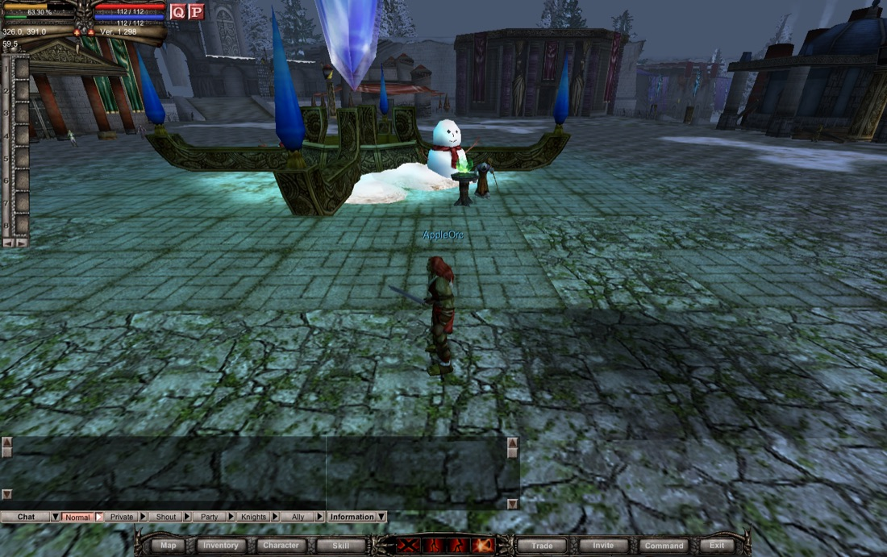
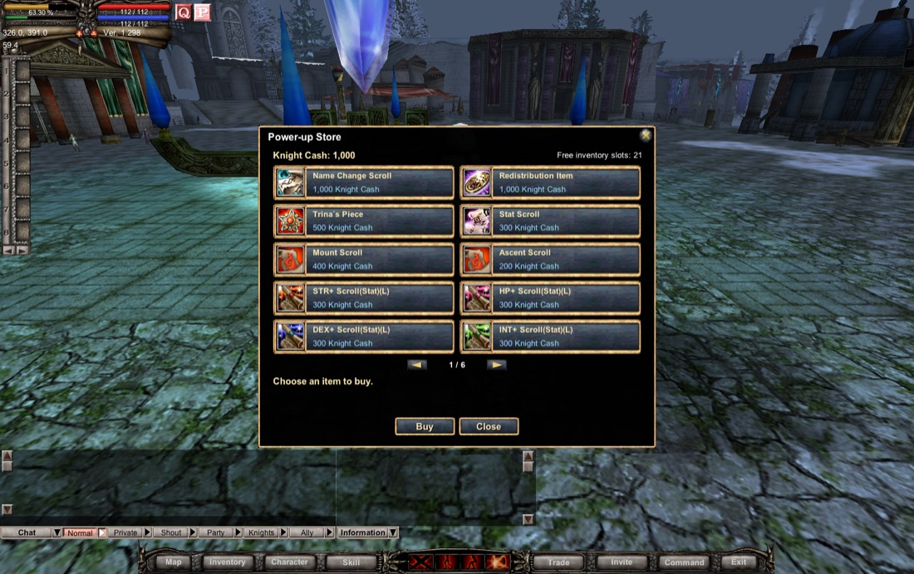
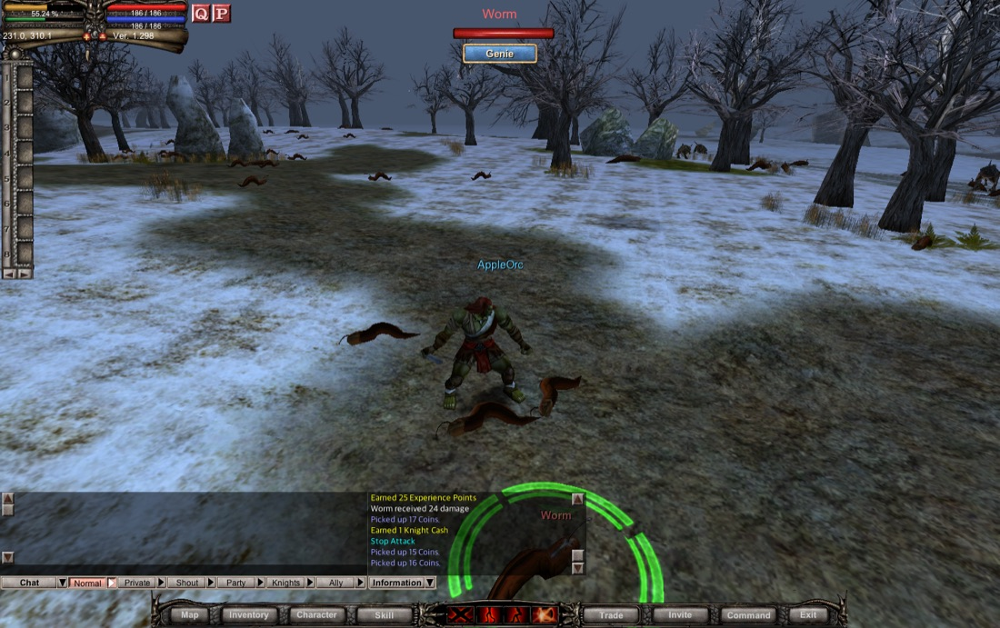
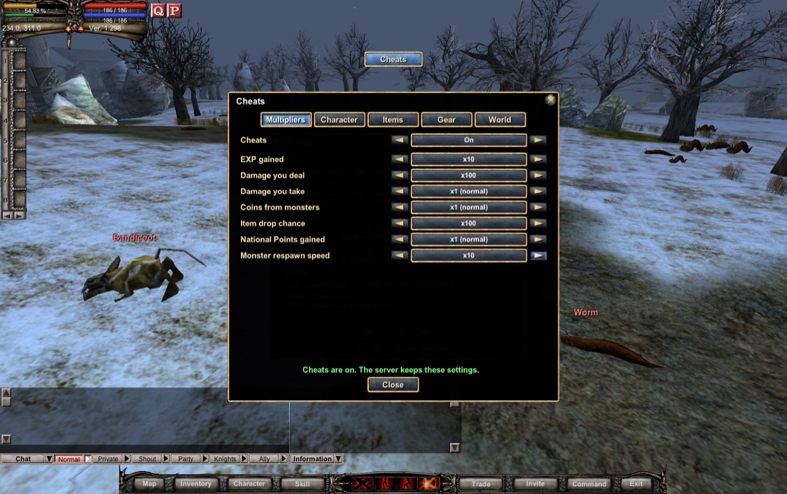

# Knight Online for Mac

**Knight Online 1.298 as a native Apple Silicon app.** You play it single-player and offline. One app holds the game client, the five game servers and the database, so you don't need Wine, CrossOver, Rosetta, Docker or a Windows PC.

This is an unofficial fork of [Open-KO](https://github.com/Open-KO/KnightOnline), the open-source rebuild of the Knight Online client and server. Besides the Mac port, it adds things the 1.298 game never had: a Power-up Store, Genie auto-hunting and a cheats menu.

**[⬇ Download the latest release](https://github.com/MostlyEmre/KnightOnline/releases/latest)**



> [!IMPORTANT]
> This fork is **not affiliated with Open-KO**. It was written with heavy help from an AI coding assistant (Claude Code). Open-KO doesn't accept AI-written code, so none of this will be offered upstream. Please don't take questions or bug reports about this fork to the Open-KO team or their Discord.
>
> Like Open-KO, it's meant for learning and personal play. Open-KO is still early, so parts of the game, such as wars, aren't implemented yet.

## Install

You need a Mac with Apple Silicon (M1 or later) running macOS 14 Sonoma or later.

1. Download `KnightOnline-<version>-macOS-arm64.zip` from [Releases](https://github.com/MostlyEmre/KnightOnline/releases/latest). It's about 370 MB, and the app takes about 830 MB once unzipped.
2. Open the zip and drag **KnightOnline.app** into your Applications folder.
3. Open the app. It isn't notarized by Apple, so the first time macOS refuses to open it. Click **Done** (**OK** on macOS 14), then go to **System Settings → Privacy & Security**, scroll down, click **Open Anyway** next to the Knight Online message, and confirm. After that it opens normally.

   If you prefer Terminal, this does the same:

   ```sh
   xattr -dr com.apple.quarantine /Applications/KnightOnline.app
   ```

To update, replace the app with the new version. Your characters are stored outside the app, so you keep them.

## Play

When you open the app, it starts the game servers in the background, which takes a few seconds, and then shows the login screen. Quitting the game stops the servers again, after they've saved your progress.

- **Log in** as `testing1` with password `testing1`. The accounts `testing1` to `testing10` all exist, each with its own name as the password, and none of them has a character yet.
- **Create a character** and play. Names containing "Knight" aren't allowed.
- **Settings:** the game starts in fullscreen. Press **Cmd-,** or the game's own Option button to change that and everything else.
- **Your saves** live in `~/Library/Application Support/KnightOnline`. The characters are in `Server/KN_online.sqlite`, and the logs are in `Logs/`. To back up, copy the folder; to start over, delete it.
- **Offline:** the servers listen only on your own Mac (127.0.0.1), so nothing goes over the internet.

### Keys this fork adds

| Key or button | What it does |
| --- | --- |
| **J** | Opens the Cheats window |
| **G** | Opens the Genie window |
| **P** button (top left, next to Q) | Opens the Power-up Store |
| **Cmd-,** | Opens Options |
| **Cmd-Tab** | Switches apps, even in fullscreen |
| Two-finger sideways swipe | Turns the camera |

## What this fork adds

### A real Mac app

- **Native on Apple Silicon.** The game draws with Metal instead of Direct3D 9. Windows, keyboard, trackpad, sound and files go through a small macOS layer. The Windows code is kept, and the Windows build still works.
- **Everything in one app.** KnightOnline.app holds the client and the five servers: login, game, AI, database writer and item manager. A small helper starts the servers when you open the game and stops them when you quit.
- **SQLite instead of SQL Server.** The servers gained a SQLite database backend, which was checked against SQL Server to give the same results. The starting database is built from [OpenKO-db](https://github.com/Open-KO/OpenKO-db). The SQL Server backend still works.
- **Fullscreen that fits a Mac.** It runs at your screen's resolution, sits below the notch, and lets you Cmd-Tab away.
- **Trackpad support.** Tap to click, and swipe sideways with two fingers to turn the camera.
- **An in-game Options window** in the game's own style replaces the Windows Option.exe. Its Display, Graphics, Sound, Controls and Performance pages also hold Mac settings: window size, scaling, trackpad, frame-rate limits and keeping the Mac awake.

### New things to do in the game

| Power-up Store | Genie | Cheats |
| --- | --- | --- |
|  |  |  |

- **Power-up Store** (the P button). It sells 53 of the game's own Power-up items for Knight Cash, which you earn by playing. A new account starts with 1,000; each level you gain pays your new level × 20, and each kill pays 1 to 10.
- **Genie** (G) hunts for you. You set it up per character. It picks targets, uses your skills, drinks potions, casts heals and buffs, sits to recover MP, and loots with a filter. It also repairs, restocks potions and arrows from the last merchant you shopped at, and goes to town when your bag is full. With a bow, it stays on the spot you chose and shoots.
- **Cheats** (J). Turn them on with the switch at the top. The server remembers your settings.
  - **Multipliers** from ×1 to ×100 for EXP, damage you deal, damage you take, coins, item drop chance, National Points and monster respawn speed. Damage you take can also be halved or turned off.
  - **Toggles:** infinite MP, no durability loss, arrows and potions that aren't used up, no weight limit, and free shops.
  - **Character:** set your level, add stat or skill points, reset stats or skills, refill HP and MP, and set coins, National Points or Knight Cash.
  - **Items and gear:** search any item by name and give yourself any amount of it, set an equipped item's +level, and repair everything.
  - **World:** teleport to a zone or to any NPC, change the weather and time of day, and kill every monster around you.
- **Loot All** button in the loot window.
- **Upgrades that work.** The Low and Middle Class upgrade scrolls sold at Charon now work. Every possible upgrade succeeds, and an impossible one is refused instead of destroying your item.

### Fixes

- Quest level requirements and the Beginner Helper reward match the official client.
- Monsters worth more than 32,767 EXP now give their EXP.
- Damage spells hurt monsters with very high resistance, such as Hyde, Antares and most bosses, instead of healing them. Resistance now stops at 200, the most the spell formula was built for.
- Going back from the game to character selection no longer crashes character creation.
- On macOS and Linux, the servers can restart right away, instead of waiting about 30 seconds for their ports to free up.

## Known issues

- It has been tested on a MacBook Air M4 with macOS 26. It's built to run on macOS 14 and 15, but nobody has tried it there yet.
- Monster spells do only 1 damage. This bug comes from Open-KO.
- Everything Open-KO hasn't implemented yet is missing here too.

## Build it yourself

You need an Apple Silicon Mac with Xcode, CMake, Ninja (`brew install cmake ninja`) and Python 3.

```sh
git clone -b macos-port https://github.com/MostlyEmre/KnightOnline.git
cd KnightOnline
git submodule update --init --depth 1 assets/Client

# 1. The client and the servers, for macOS 14 and later
cmake -S . -B build/mac-app -G Ninja -DCMAKE_BUILD_TYPE=Release -DCMAKE_OSX_DEPLOYMENT_TARGET=14.0 \
  -DOPENKO_BUILD_MACOS_CLIENT=ON -DOPENKO_BUILD_SERVERS=ON -DOPENKO_BUILD_TESTS=OFF \
  -DOPENKO_DB_BACKEND=SQLITE -DOPENKO_FETCH_CLIENT_ASSETS=OFF
cmake --build build/mac-app

# 2. The starting database, from OpenKO-db v0.1.2
git clone --depth 1 --branch v0.1.2 https://github.com/Open-KO/OpenKO-db.git build/openko-db
mkdir -p build/seed
python3 port/db/openkodb_to_sqlite.py build/openko-db build/seed/seed.sql
build/mac-app/bin/Release/openko-sqlite-load build/seed/KN_online.sqlite build/seed/seed.sql

# 3. The app, plus the release zip
python3 port/app/make_app.py --build build/mac-app --assets assets \
  --seed build/seed/KN_online.sqlite --out build/app --zip
```

This leaves `build/app/KnightOnline.app` and `build/app/KnightOnline-<version>-macOS-arm64.zip`. The version comes from [`port/app/VERSION`](port/app/VERSION), and each release is tagged `v<version>`.

The Windows build and the SQL Server backend build as they do upstream; see [Open-KO's setup guide](https://github.com/Open-KO/KnightOnline/wiki/Project-Setup-(Windows)).

## How the port is organized

- [`port/`](port/README.md) holds the port's own tools: the app packager, the server supervisor, the database converter, and the reference rigs used to check the port against Windows and SQL Server.
- [`port/docs/`](port/docs) holds the reports for each phase of the port and the designs for Genie and the cheats.
- `src/N3Base/Platform/` is the platform layer. `Win32/` holds the original Windows code, and `macOS/` holds the Mac versions and the Metal renderer.
- `src/db-library/sqlite/` is the SQLite database backend.

## Credits and licence

- The client and server code comes from [Open-KO](https://github.com/Open-KO/KnightOnline) and is MIT licensed (see [LICENSE](LICENSE)). The game data comes from Open-KO's [ko-client-assets](https://github.com/Open-KO/ko-client-assets), and the database from [OpenKO-db](https://github.com/Open-KO/OpenKO-db).
- Knight Online and its game data belong to their respective owners. This project isn't affiliated with them.
- For the original project, its goals and its rules, read [Open-KO's README](https://github.com/Open-KO/KnightOnline#readme).
