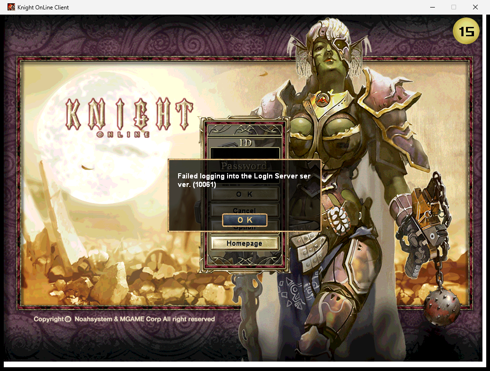
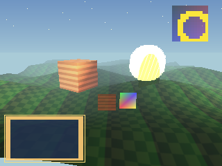
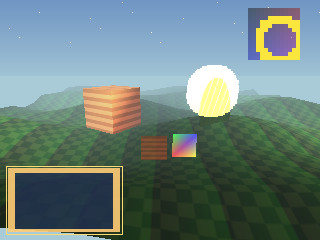
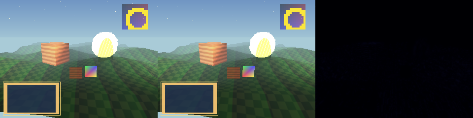

# Phase 0 survey: KnightOnline.app on Apple Silicon

Branch `macos-port` of [MostlyEmre/KnightOnline](https://github.com/MostlyEmre/KnightOnline), based on upstream `7d6cf810` (#845, 2026-08-07, still upstream HEAD on 2026-10-24). No port code is written yet. Phase 0 added only tooling under `port/` and three workflows named `port-*`. Upstream files are untouched.

## Summary

| Question | Answer |
|---|---|
| Rig A: Windows/WARP reference renders | **Works.** On `windows-latest` (Windows Server 2025, no GPU), plain D3D9 lands on the WARP-backed *Microsoft Basic Render Driver* (`d3d10warp.dll`). Renders are bit-identical across runs, and also between plain D3D9 and D3D9On12-on-WARP. The unmodified upstream client also comes up and renders its 1.298 login screen there. The UTM fallback isn't needed. |
| Rig B: SQL Server reference | **Works.** On `ubuntu-latest`, upstream's docker-compose plus kodb-util load OpenKO-db v0.1.2 into SQL Server 2022 (`SQL_Latin1_General_CP1_CI_AS`). All five servers, built natively against it via unixODBC + msodbcsql18, start and stay up. |
| Client census | 1,443 D3D9 call sites over 56 distinct methods in 116 files. D3DX is nearly gone (2 calls). Win32 code is concentrated in a few files. The fixed-function state set the client and its assets actually use is small (§2). |
| Database census | 15 stored procedures called (Aujard 14, VersionManager 1), 14 live non-procedure queries, and 35 tables loaded at startup. Ten ranked hazards where a naive SQLite port would silently diverge from SQL Server (§3). |
| Renderer recommendation | **Native Metal with fixed-function emulation**, behind a D3D9-shaped device interface in N3Base; Windows keeps a pass-through D3D9 implementation. The spike reaches mean FLIP 0.0043 against WARP on a scene built from the census. DXVK can't create a device on MoltenVK. Vulkan over MoltenVK costs more for no benefit on this target (§5). |
| FLIP threshold proposal | Three criteria per scene, not just the mean: mean ≤ 0.01, p99 ≤ 0.05, and ≤ 0.1% of pixels above 0.1, outside text masks. Calibrated by injecting realistic emulation bugs: every one fails, and the correct emulation passes with margin (§6). |
| Decisions for you | §9 (renderer backend, threshold, Xcode, how to run upstream's workflows on the fork). |

---

## 1. Upstream state and patterns to reuse

**Issues.**
- **#671** (open) is the umbrella. Its maintainer's position: keep Win32 on Windows, avoid SDL ("it creates so many support/compatibility issues"), test any D3DX replacement against D3DX (#663), handle DX types used in file formats with care, and treat the edge-of-screen input nuance as real.
- **#693** (Vulkan) is an empty stub.
- **#695** tracks removing DX types. The math types and `D3DLIGHT9` are done; `D3DVIEWPORT9`, `__Material`, `__ColorValue` and `D3DCOLOR` remain.
- **#698** (windowing): roll our own per-platform windowing, keep Win32 on Windows.
- **#699** (input): `CLocalInput` encapsulates DirectInput; `DIK_` codes are spread around; `CN3UIEdit` drives a hidden Win32 EDIT control and is the hard part.
- **#700** (networking): use asio, keep the behaviour the same.
- None of these has code. Upstream has had no commits since August.

**Merged work that made the servers portable**, whose patterns I'll reuse:

| PR | Pattern |
|---|---|
| #601, #618 | Win32 types → C++ standard types, `BOOL` → `bool` |
| #619 | Winsock/IOCP → standalone **asio 1.36**. Same behaviour, TCP sends queued. `SocketManager`/`TcpSocket` naming. |
| #621 | Shared memory → **Boost.Interprocess**, with Boost hidden from callers |
| #627 | MFC timers / Win32 threads → `std::thread` wrapper (`Thread`) |
| #631, #691 | File I/O → `std::ifstream`, and **llfio** memory-mapped reads in the engine (client file I/O is already mostly portable) |
| #643 | MFC UI → console app with FTXUI |
| #653, #657, #722 | `_MSC_VER` checks stripped. CMake for everything, **warnings as errors**, gcc/clang clean, `strcpy_safe`. |
| #702 | macOS server builds in CI |
| #719 | DirectSound → **OpenAL-soft** with streamed mpg123 decoding. Client audio is already portable. |
| #798 | `AutoTranslate=no` forced in the ODBC connection string |
| #797 | `docker/cross-compile-client`: MinGW cross-build of `KnightOnLine.exe` run under Proton. Reused here as a **local Windows build check** (see below); Proton itself isn't used for anything. |

**Local Windows build check.** `docker/cross-compile-client`'s CMake invocation, run with Homebrew's mingw-w64 on this Mac, builds the unmodified Windows client in about 56 s. It produces the exact compile database for the census and lets every N3Base change be compiled for Windows before CI sees it.

---

## 2. Client census

Full tables: [`port/census/client-census.md`](../census/client-census.md), generated by [`client_census.py`](../census/client_census.py). The script parses all 191 client translation units with libclang, using the MinGW compile commands (`_N3GAME` defined, tool-only code excluded), with 0 parse errors. Every call, macro and type reference is attributed to the platform header that declares it, and each site is counted once. Asset-driven state comes from [`asset-materials.md`](../census/asset-materials.md), produced by [`asset_material_scan.py`](../census/asset_material_scan.py), which reads materials using the engine loaders' own read order.

### 2.1 Platform API by area

| Area | Call sites | Distinct APIs | Files | Where it actually lives | Port approach |
|---|---:|---:|---:|---|---|
| D3D9 | 1,443 | 56 methods | 116 | everywhere `s_lpD3DDev` is used | device interface (§5) |
| D3DX9 | 2 | 2 | 2 | `D3DXCreateTextureFromFileEx` (N3Texture, non-NTF images), `D3DXLoadSurfaceFromSurface` (DFont) | small image loader + blit |
| DirectInput 8 | 9 | 9 | 1 | `LocalInput.cpp`. `DIK_` codes: 132 uses, 54 keys, 37 files. | keep the `DIK_` values; fill the state from AppKit key events |
| user32 (windowing/messages/cursor) | 155 | 47 | 54 | `WarFareMain.cpp` (WinMain/WndProc), `GameProcedure.cpp` (cursors, `ChangeDisplaySettings`), `N3UIEdit.cpp`, `LocalInput.cpp` | AppKit window/run loop in a platform layer |
| IME (imm32) | 4 | 4 | 1 | `N3UIEdit.cpp` (plus a hidden EDIT control via `SendMessage`/`SetWindowText`) | `NSTextInputClient` view feeding `CN3UIEdit` |
| GDI | 73 | 25 | 9 | `DFont.cpp` (text rasterised to a texture: `CreateFont` grayscale-AA, `ExtTextOut`, `GetTextExtentPoint32`), `JpegFile.cpp` (screenshots) | CoreText rasteriser; framebuffer readback |
| Winsock | 21 | 15 | 1 | `APISocket.cpp` only (`WSAAsyncSelect` → `WM_SOCKETMSG`) | asio, events posted to the main loop (#700) |
| File I/O (Win32/CRT) | 19 | 6 | 3 | `_findfirst` (GameProcMain), `GetPrivateProfileString` (login), `GetTempFileName` (JpegFile) | `std::filesystem`, existing `CIni` |
| Timers / process | 32 | 8 | 11 | `timeGetTime` (13), `QueryPerformanceCounter`, `Sleep`, `GetLocalTime`, `GetModuleFileName` | `<chrono>` / `mach_absolute_time` |
| Registry | 10 | 5 | 1 | `GameProcedure.cpp` | ini file under Application Support |
| CryptoAPI | 12 | 8 | 1 | `WinCrypt.cpp`: SHA-1-derived RC4 key, only for NTF v7 textures. The 1.298 assets have **none** (all 6,710 parseable `.dxt` headers are v3). | portable SHA-1 + RC4, or compile out |
| MS CRT extensions | 36 | 7 | 17 | `_splitpath`/`_makepath` (24), `_strnicmp`, `_strlwr`, `_wfopen_s` | `std::filesystem` / small helpers |
| Platform type names | 1,468 Win32 + 615 D3D9 refs | | 179 | most used: `D3DCOLOR` 368, `POINT` 263, `RECT` 218, `BOOL` 174, `HRESULT` 139, `DWORD` 104, `HWND` 40 | portable typedefs with fixed widths (LP64!) |

Altogether 232 client files touch some platform API, but outside D3D9 and the type names, the real work sits in about ten files.

### 2.2 The fixed-function state set the renderer must support

From the code (literal values at 1,443 sites) and the assets (53,552 materials in 4,634 files, which reduce to 38 distinct combinations):
- **Texture stages:** at most 3. Colour ops: `SELECTARG1`, `MODULATE`, `ADD`, `DISABLE` in code; assets add `MODULATE2X` (68 materials).
  - Args: `TEXTURE`, `DIFFUSE`, `CURRENT`, `TFACTOR`.
  - Stage 1/2 alpha ops stay at D3D's default `DISABLE` (terrain).
  - `TEXCOORDINDEX` 0/1.
- **Blending:** `SRCALPHA/INVSRCALPHA`, `ONE/ONE`, `ONE/INVSRCALPHA`, `ZERO/SRCCOLOR`, `SRCCOLOR/INVSRCCOLOR`, `BLENDOP_ADD`.
- **Alpha test:** globally on, `GREATER`, ref 0 (`CN3Eng::Init`).
- **Depth and fill:** `ZENABLE`/`ZWRITEENABLE` toggles, `CULL_NONE/CCW`, `FILL_SOLID/WIREFRAME`, scissor (1 site).
- **Fog:** **EXP2 table fog** (`FOGTABLEMODE = FOGVERTEXMODE = EXP2`, `RANGEFOGENABLE`), density `1/(0.37·far)`.
- **Lighting:** fixed-function, directional + point, `SPECULARENABLE TRUE`, `COLORVERTEX`/`DIFFUSEMATERIALSOURCE` switching (PlayerBase), `NORMALIZENORMALS` left `FALSE`.
- **Samplers:** `POINT/LINEAR`, mip `NONE/POINT/LINEAR`, `WRAP/CLAMP/MIRROR/BORDER` (border used once, red, snow), **`MIPMAPLODBIAS = -1` on every sampler**.
- **Vertex formats passed to `SetFVF`:** `VNT1`, `VNT2`, `CV`/`XYZCOLOR` (same bits), `XYZCOLORT1`, `XYZCOLORT2`, `XYZT1`, `TRANSFORMED` (XYZRHW+diffuse+tex), `TRANSFORMEDCOLOR`, `XYZ|NORMAL|DIFFUSE|TEX2` (water), and plain `XYZ` (debug mesh). That's 9 distinct layouts; `My_3DStruct.h` defines more (`CSV` with specular, `PARTICLE` with point size, `TRANSFORMEDT2`, ...) that no client draw uses.
- **Primitives:** triangle list/fan/strip, line list/strip, point list.
  - Mostly `DrawPrimitiveUP`/`DrawIndexedPrimitiveUP` (57 sites). Only 7 vertex-buffer creation sites, and no `CreateIndexBuffer` call in client code.
- **Texture formats in the assets** (from all `.dxt` headers): DXT3 2,296, DXT1 2,163, A4R4G4B4 1,344, A1R5G5B5 883, A8R8G8B8 23, DXT4 1. Largest is 1024². The code also creates A4R4G4B4 for fonts and accepts R5G6B5/X8R8G8B8/R8G8B8 paths.
- **No shaders anywhere.** `SetVertexShader` is only used to re-set an FVF.

### 2.3 Text

`DFont` asks GDI for grayscale-antialiased (`ANTIALIASED_QUALITY`) **Arial** (3,119 references in UI files) and **굴림/Gulim** (593, plus the UI manager's default). macOS ships Arial but not Gulim, and CoreText rasterises differently from GDI. Text is therefore the one area where pixel parity with the Windows reference isn't achievable by construction (§6). Whether the Windows Server runner has Gulim installed decides what the reference itself shows; the capture mode will log the resolved face on both sides.

### 2.4 LP64 exposure

Raw `Read(&x, sizeof(T))` of on-disk data mostly uses fixed-width types: `int` 106, `float` 81, `__Vector3` 36, `bool` 28, `uint32_t` 20. The non-trivial structs read raw are `__Material` (`D3DMATERIAL9` + six `uint32_t`), `D3DLIGHT9` (already wrapped as `__D3DLight9`), `RECT` and `__DXT_HEADER`. `long` appears 7 times and `DWORD`/`LONG`/`ULONG` 91 times. These need fixed-width portable definitions plus `static_assert`s (Phase 3). Network packets go through byte buffers, which are portable.

---

## 3. Database census

Full document: [`port/census/db-census.md`](../census/db-census.md), about 820 lines, every claim cited to file:line. Spot-checked by hand, and two open questions were answered by rig B.

- **Procedures called: 15 of 70.**
  - Aujard: `ACCOUNT_LOGIN`, `ACCOUNT_LOGOUT`, `CLAIM_USER_RANK_STIPEND`, `CREATE_KNIGHTS`, `CREATE_NEW_CHAR`, `DELETE_KNIGHTS`, `LOAD_ACCOUNT_CHARID`, `LOAD_CHAR_INFO`, `LOAD_KNIGHTS_MEMBERS`, `LOAD_USER_DATA`, `NATION_SELECT`, `UPDATE_KNIGHTS`, `UPDATE_USER_DATA`, `UPDATE_WAREHOUSE`.
  - VersionManager: `LOAD_PREMIUM_SERVICE_USER`.
  - AIServer, Ebenezer and ItemManager call none.
  - None of the 15 uses TRY/CATCH, cursors, loops, TOP, temp tables, dynamic SQL, MERGE or IDENTITY. They are straight-line T-SQL with OUTPUT params, `@@ERROR`, early `RETURN`, and `NOCOUNT` off.
- **Other queries: 14 live.** 6 hand-written SQL strings in Aujard, 4 of which paste packet strings into SQL. The rest are SqlBuilder `SELECT [TOP n] [cols] FROM [table]` and the record loaders.
- **Startup loads:** 44 loader calls over 35 distinct tables (AIServer 16, Ebenezer 25, Aujard 1, VersionManager 1). Only `KNIGHTS_SIEGE_WARFARE` is empty, and that's allowed.
- **Schema:**
  - 76 tables; no IDENTITY columns, no triggers; 1 unused view.
  - Collation `SQL_Latin1_General_CP1_CI_AS`, from rig B.
  - **6 varchar columns hold packed binary with embedded NULs**: USERDATA ×4, WAREHOUSE ×2.
  - The `5_CreateTable_*` scripts are stale (missing `isClaimed*`). kodb-util builds from jsonSchema, so the converter must do the same.
- **Hazards for SQLite, ranked:**
  1. case- and trailing-space-insensitive equality on IDs and names
  2. NUL-containing blobs bound as text
  3. loaders that depend on row order (`LEVEL_UP` by position, NPC serials from `K_NPCPOS` heap order)
  4. proc quirks: NULL-initialised OUTPUT params, early RETURN means no result set, partial commits
  5. the `affected_rows()` contract (0 = fail, -1 = success)
  6. `CAST(N'…' AS DateTime)`, local-vs-UTC, `DATEDIFF(dd)`
  7. no length/range/NOT NULL enforcement unless declared
  8. the seed files are UTF-8, but SQL Server stores CP1252 bytes
  9. column binding by exact name and by ordinal
  10. single-writer concurrency across four processes

Server-side facts from rig B that Phase 1 and Phase 5 depend on:
- **Listening sockets:** AIServer `0.0.0.0:10020`, Ebenezer `0.0.0.0:15001` plus UDP `0.0.0.0:8888`, VersionManager `0.0.0.0:15100`, Ebenezer telnet `127.0.0.1:2324`. Everything has to move to `127.0.0.1` for proof 6.
- **Shared memory:** Ebenezer, Aujard and ItemManager communicate through Boost.Interprocess shared memory. That works on Linux, but upstream's macOS CI only builds the servers and never runs them, so it's the first thing to verify in Phase 1.
- **Row counts:** the servers log "X loaded" without counts, so proof 2's startup-row-count comparison needs a small logging addition in the loaders.
- **Baseline noise:** upstream logs errors even with no client attached, for example `Npc::IsNoPathFind` (Victory Gate) and `GameSocket::Parsing: Unhandled opcode 32` between Ebenezer and AIServer. Proof 4 will be judged against this baseline, captured in the rig B artifacts.

---

## 4. Reference rigs

### Rig A: Windows/WARP (`.github/workflows/port-rig-a-render.yml`, `port-rig-a-ffspike.yml`)

- **Adapter:** the runner has a Hyper-V video adapter and an interactive console session (`runneradmin`, 1024×768). D3D9 enumerates *Microsoft Basic Render Driver*, driver `d3d10warp.dll` 10.0.26100.33648 ([`warp-adapter.txt`](phase0/rig-a/warp-adapter.txt)).
- **Caps:** HW T&L, 8 stages, 8 lights, table/W/Z fog, MODULATE2X, scissor, LOD bias, mirror and border addressing, and DXT1/3/5 + A4R4G4B4. R8G8B8 textures aren't supported, and the assets have none.
- **Determinism:** the spike scene was rendered four times, twice by plain D3D9 and twice by D3D9On12 on an explicitly created WARP12 device. **All four PNGs have the same SHA-256.** The reference is deterministic and doesn't depend on the route.
- **Real client:** the first attempt failed because the runner lacks the legacy D3DX runtime ([screenshot](phase0/rig-a/missing-d3dx9-runtime.png)). The workflow now installs Microsoft's DirectX June 2010 redistributable, and the unmodified upstream client renders its login scene on WARP:

  

  (The message box is the expected "can't reach the login server". No server was running.)

What remains for rig A is the capture mode itself, a Phase 4 deliverable: scripted scenes, a fixed clock, a seeded RNG, offscreen render, PNG out, and the same code in both builds. The spike already proves the oracle half.

### Rig B: SQL Server (`.github/workflows/port-rig-b-database.yml`)

`docker compose up sqlserver kodb-util` → kodb-util `cleanImport` (OpenKO-db `bec6194`, v0.1.2) → msodbcsql18 DSN `KN_online` → CMake/Ninja build of the five servers → start them in upstream's documented order (AIServer, Ebenezer, Aujard, VersionManager, ItemManager) with `--headless` → after 60 s all five are still running, and the listening sockets are recorded → `SIGINT` shutdown.
- [`rig-b-db-inspect.txt`](phase0/rig-b-db-inspect.txt) holds the collation, all 70 procedures, per-table row counts, and every char/varchar/binary column with its length and collation.
- [`rig-b-listening.txt`](phase0/rig-b-listening.txt) holds the sockets.

What remains for rig B, all Phase 1: the same servers built against the SQLite backend in the same job, the procedure-parity harness (same inputs to both backends, diff of result sets, output params and return codes), and startup row-count logging.

---

## 5. Renderer: spike and recommendation

### 5.1 The spike (`port/spikes/ffspike/`)

[`ffscene.h`](../spikes/ffspike/ffscene.h) is one deterministic scene, procedural so it needs no assets, built only from the census state set:
- sky fan; point-list stars
- three-stage fogged lit terrain with `VNT2`, DXT1 with mips, a mirrored X8R8G8B8 lightmap, and the -1 LOD bias
- a lit box with MODULATE2X, a DXT3 texture, a point and a directional light, specular, and a scaled world matrix with `NORMALIZENORMALS` off
- double-sided DXT1-punch-through foliage with alpha test and blending
- a quad with an unbound texture
- a TFACTOR quad
- an additive DXT5 effect billboard
- pre-transformed A4R4G4B4 UI with point sampling
- a scissored, magnified icon
- a pre-transformed UI line strip

It is described in D3D9's own numeric values (static-asserted against `d3d9types.h`), rendered by [`d3d9_main.cpp`](../spikes/ffspike/d3d9_main.cpp) on WARP and by [`metal_main.mm`](../spikes/ffspike/metal_main.mm), a fixed-function emulation in one Metal shader of about 210 lines run under Metal API validation, then compared with [`flip_compare.py`](../rigs/rig-a/flip_compare.py).

| | WARP (reference) | Metal (this Mac, M4) |
|---|---|---|
| full scene |  |  |

Reference | test | FLIP map:

**Result: mean FLIP 0.0043, p99 0.020, worst pixel 0.035, no pixel above 0.1; 90% of pixels bit-exact, worst channel error 6/255** ([per-draw table](phase0/ffspike/flip-report.md)).
- Sky, stars, lines, UI panel, scissored icon, FX glow, TFACTOR and the unbound-texture draw are **bit-exact**.
- Terrain is 89% bit-exact with a maximum error of 2/255. The difference is filtering and fog rounding.

The first attempt had mean FLIP 0.0116, with 2% of pixels above 0.1 ([map](phase0/ffspike/flip-scene-first-attempt.png)). Three D3D9/WARP behaviours, each confirmed against the reference images, closed the gap. They go straight into the Phase 4 backend:
1. **An unbound texture samples as opaque white** in the fixed-function combiner. Metal must not leave the slot undefined.
2. **Point sampling picks texel `floor(u·size)`** even when the interpolated coordinate lands exactly on a texel edge. The Apple GPU lands a hair below it and picks the previous texel. Fixed by snapping to the texel WARP would pick. This mattered for UI art magnified by non-integer factors.
3. **The alpha test compares the unquantised alpha** against `ALPHAREF/255`. Rounding alpha to 8 bits first discards fringe pixels WARP keeps, which mattered for additive effects with the engine's always-on `GREATER 0` test.

Also learned:
- **Keep native BC decoding.** A CPU BC decoder written to the D3D formulas with round-to-nearest was *further* from WARP (terrain 81% bit-exact vs 89%) than the M4's hardware decode.
- **Metal API validation is worth having on from day one.** It caught a real bug on the first run: inline vertex data larger than 4 KB.

### 5.2 Options compared

| | Native Metal with FF emulation (**recommended**) | Vulkan over MoltenVK | D3D9 translation layer |
|---|---|---|---|
| Feasible on this Mac | Yes. Spike above. | Yes, but the fixed-function emulation still has to be written, in a more verbose API | **No.** DXVK v3.1.1 hard-requires `geometryShader`, `shaderCullDistance` and `VK_EXT_depth_clip_enable` (`src/dxvk/dxvk_device_info.cpp:834,847`). MoltenVK 1.4.2 on the M4 reports all three unsupported (`vulkaninfo`), so DXVK can't create a device. wined3d, Gallium Nine, D3DMetal and DXMT are either Wine-hosted, Linux-only, or D3D10+. |
| Layers between game and GPU | 1 | 2 (Vulkan → SPIR-V → MSL → Metal) | 3+ |
| Proof 5 (Metal validation: 0 errors) | Errors map to our own calls | Errors are in MoltenVK's calls | n/a |
| Bundle | system frameworks only | + `libMoltenVK.dylib` | n/a |
| Fits "no translation layer" | Yes | Arguably not (MoltenVK translates) | No |
| Reuse elsewhere | Mac only. The device interface still allows a Vulkan backend later (upstream #693). | Linux too | |

**Shape of the work (Phase 4).** Replace `LPDIRECT3DDEVICE9 s_lpD3DDev` and the four resource interfaces with N3Base classes that keep the **same method names and D3D9 enum values** used at the 1,443 sites. On Windows they forward one-to-one to D3D9, so behaviour is unchanged and the rebase surface is small. On macOS a Metal backend implements exactly the §2.2 set. Estimated size:
- portable D3D9 constants/types header (about 150 constants from the census): ~400 lines
- device and resource interface plus D3D9 forwarding: ~800 lines
- Metal backend: ~3,500 lines. That covers state tracking, pipeline/depth/sampler caches, a function-constant-specialised FF shader, a ring buffer for the 57 `*UP` draw sites, texture upload and format conversion (A1R5G5B5, A4R4G4B4, DXT2/4), Lock/Unlock emulation, readback for screenshots, `CAMetalLayer` present and vsync, wireframe, points, lines and scissor.
- call-site edits: mostly mechanical type changes in about 20 files

**Main risks.**
- (a) Behaviours like the three above that the spike didn't exercise: mip LOD selection on oblique terrain, `BORDER` with a non-black colour (Metal only offers black/white/transparent, so it needs shader emulation), DXT2/4 premultiplied alpha, fog on pre-transformed vertices, and `COLORVERTEX` switching.
- (b) Text: CoreText vs GDI (§6).
- (c) Capture determinism: time of day, animation clocks and particle RNG must be injectable identically in both builds.
- (d) `CN3UIEdit`'s hidden-EDIT-control design (Phase 3, not renderer).

Mitigations: the spike harness extends naturally. Each new behaviour becomes another draw in `ffscene.h`, checked against WARP on every push.

---

## 6. Proposed image-parity threshold (proof 1)

The spike measured what a correct emulation scores. I then injected four realistic bugs into the Metal side ([full tables](phase0/ffspike/flip-injected-defects.md)):

| Full scene, NVIDIA FLIP at 67 PPD | mean | p99 | pixels > 0.1 |
|---|---:|---:|---:|
| Correct emulation | **0.0043** | **0.020** | **0.00%** |
| Normals normalized (`NORMALIZENORMALS` ignored; box lighting about 11% off) | 0.0124 | 0.270 | 3.33% |
| MODULATE2X treated as MODULATE | 0.0304 | 0.806 | 4.11% |
| D3D9 half-pixel offset missing | 0.0426 | 0.254 | 9.29% |
| Fog density +10% | 0.0597 | 0.203 | 28.4% |

The mean alone is a poor detector: the normals bug, a real and visible lighting error, would pass a 0.02 mean threshold. The tail catches all four. Proposal for each rig A scene, Mac vs Windows/WARP, at FLIP's default 67 PPD:
- **mean FLIP ≤ 0.01**, which is 2.3× the measured floor
- **p99 ≤ 0.05**, which is 2.5× the floor and 4–16× below every injected bug
- **≤ 0.1% of pixels with FLIP > 0.1**; the floor is 0%, and the bugs range from 3.3% to 28%

**Text regions are judged separately.** The capture mode will emit a mask of every string rectangle it drew. Pixels outside the mask must meet the three limits above. Inside it, GDI and CoreText can't match, so the check is that the same strings were drawn in the same rectangles (logged by the capture mode on both sides) plus a looser FLIP bound for the text pixels, proposed at mean ≤ 0.15, to be set from the first real login-screen capture.

**Recalibration.** In Phase 4 the same injected-defect suite runs on every real scene (login, character select, Moradon day and night, dungeon, UI-heavy screen, character close-up). If real content raises the floor, the limits move with it, but only while every injected defect still fails. That keeps the threshold meaningful rather than tuned to pass.

---

## 7. Adjustments to the later phases

- **Phase 1:**
  - Verify Boost.Interprocess shared memory between Ebenezer, Aujard and ItemManager on macOS before anything else, since it has never run there.
  - Build the SQLite schema from jsonSchema, not the `5_` scripts.
  - Vendor the SQLite amalgamation, so no system dylib is needed.
  - Use one database file for both DSN roles. Enable WAL and a busy timeout.
  - Store seed strings as CP1252 bytes to match what SQL Server stores.
  - Add per-table row-count logging to the loaders, so proof 2 can compare.
- **Phase 2:** the client already builds with `-Wall -Werror` under MinGW gcc. Apple Clang will raise its own set, so it gets its own warning baseline. Every N3Base change is compiled locally for Windows via MinGW before CI.
- **Phase 3:** keep the `DIK_` values and translate AppKit key codes into them. Replace `WSAAsyncSelect` with asio, posting into the main loop. Replace `ChangeDisplaySettings` with native fullscreen and the registry with an ini file. Replace the hidden EDIT control with an `NSTextInputClient` view. No SDL.
- **Phase 4:** promote the spike to the device interface and backend from §5. Add the capture mode with an injectable clock and RNG, and run math tests against D3DX reference values produced on rig A (D3DX9 on `windows-latest`).
- **Phase 5:** bind every listener to 127.0.0.1 (four sockets today are on `0.0.0.0`).

## 8. Proof status after Phase 0

No proof can pass before port code exists. What exists toward each:

| Proof | Status |
|---|---|
| 1 Image parity | Oracle proven deterministic (rig A). FLIP tooling and threshold proposed and calibrated. Real-scene capture mode is Phase 4. |
| 2 Database parity | Oracle running (rig B). Harness is Phase 1. |
| 3 Persistence | — |
| 4 Protocol | Server-side baseline noise recorded (rig B logs). |
| 5 Tests / sanitizers / Metal validation | Metal API validation is in use and clean on the spike. Upstream unit tests not yet run on arm64. |
| 6 Native proof | Listening-socket baseline recorded: four listeners on `0.0.0.0` to fix. |
| 7 Instruments | Blocked until Xcode is installed (§9). |
| 8 Upstream workflows on the fork | Not run yet: GitHub hasn't registered upstream's workflows on the fork (§9). |

## 9. What I need from you

1. **Renderer backend:** native Metal with fixed-function emulation behind a D3D9-shaped N3Base device interface (§5). Per your instructions, I won't move off it later without asking.
2. **Parity threshold:** the three-criteria-plus-text-mask proposal (§6), with Phase 4 recalibration under the injected-defect rule.
3. **Xcode:** only the Command Line Tools are installed. Instruments (proof 7) and Metal frame capture need full Xcode, from the App Store. Not needed until Phase 4.
4. **Upstream workflows on the fork (proof 8):** GitHub only registers a workflow after a push that changes it, so upstream's `build_cmake_all`, `build_msbuild_all`, `clang-format-check`, `clang-tidy-check` and `codeql` haven't run on the fork yet. The cleanest trigger is a **draft PR inside your fork** (`MostlyEmre:macos-port` → `MostlyEmre:master`, never upstream), which fires all their `pull_request` triggers on every push. Alternatively, merge to the fork's `master` at phase ends. Which do you prefer?

## Reproducing

- Client census: build the Windows client with MinGW (`cmake -S . -B build/mingw-client -G Ninja -DCMAKE_SYSTEM_NAME=Windows -DCMAKE_C_COMPILER=x86_64-w64-mingw32-gcc -DCMAKE_CXX_COMPILER=x86_64-w64-mingw32-g++ -DOPENKO_BUILD_SERVERS=OFF -DOPENKO_BUILD_TESTS=OFF -DOPENKO_FETCH_CLIENT_ASSETS=OFF -DCMAKE_EXPORT_COMPILE_COMMANDS=ON`), then run `python3 port/census/client_census.py build/mingw-client/compile_commands.json . port/census` (needs `pip install libclang`).
- Asset materials: `python3 port/census/asset_material_scan.py assets/Client port/census/asset-materials.md`.
- Metal spike: `clang++ -std=c++20 -fobjc-arc -O2 port/spikes/ffspike/metal_main.mm -framework Metal -framework Foundation -o ffspike_metal && MTL_DEBUG_LAYER=1 ./ffspike_metal --out scene.png`. Add `--inject <defect>` to reproduce §6.
- WARP references: the `Port: renderer spike (D3D9 on WARP)` workflow artifact. Then `python3 port/rigs/rig-a/flip_compare.py <warp dir> <metal dir> <out dir>`.
